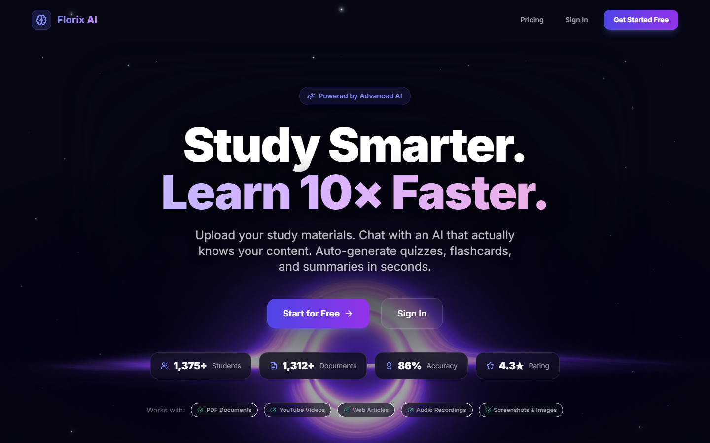
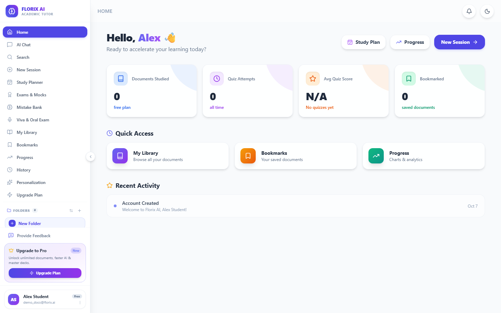
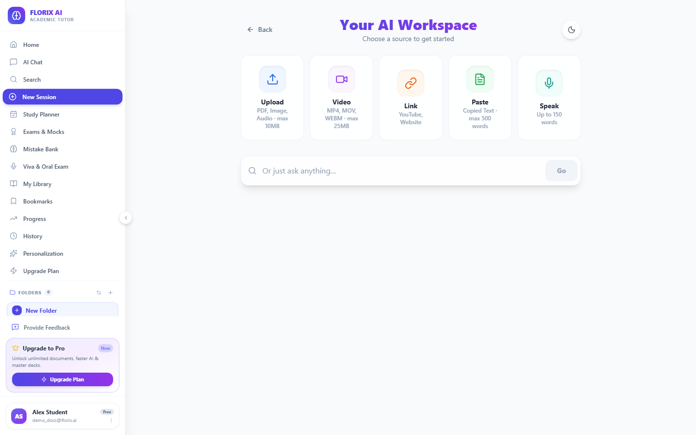
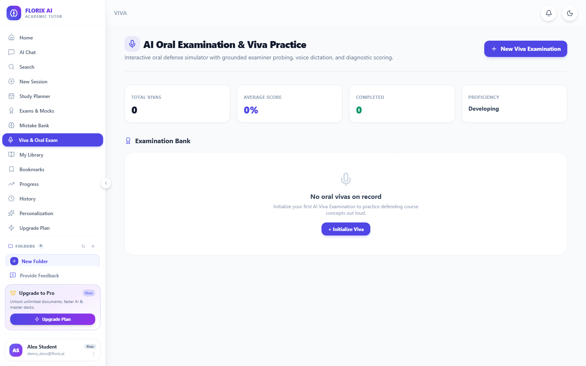
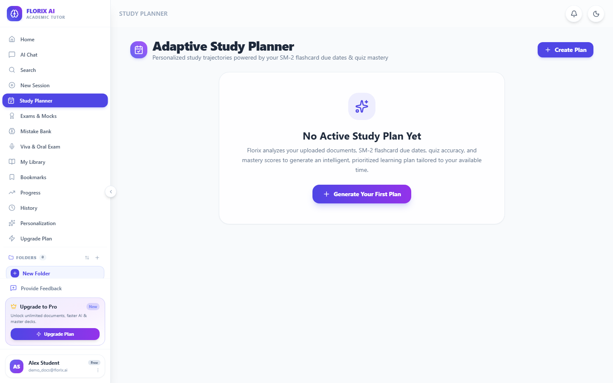
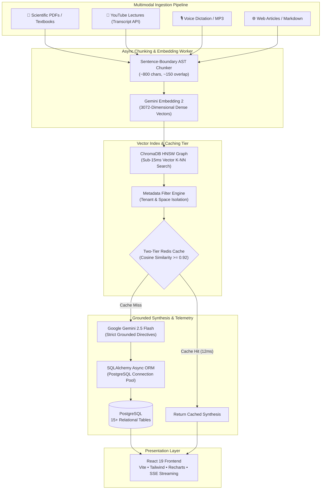

# Florix AI 🧠 — Asynchronous Multimodal RAG Platform & Adaptive Learning Engine

[](https://florix-ai.vercel.app)
[](https://fastapi.tiangolo.com)
[-FC521F.svg?style=for-the-badge&logo=chroma&logoColor=white)](https://www.trychroma.com/)
[-336791.svg?style=for-the-badge&logo=postgresql&logoColor=white)](https://www.postgresql.org/)
[](https://ai.google.dev/)
[](https://www.docker.com/)
[-brightgreen?style=for-the-badge&logo=pytest&logoColor=white)](https://pytest.org/)

> 🌐 **Live Production Application:** [https://florix-ai.vercel.app](https://florix-ai.vercel.app)  
> *Experience real-time multimodal ingestion, interactive oral viva defenses, and adaptive spaced repetition live in production.*

**Florix AI** is an enterprise-grade, asynchronous multimodal **Retrieval-Augmented Generation (RAG)** platform. It converts dense, unstructured educational inputs—scientific PDFs, textbooks, YouTube lecture transcripts, web articles, voice notes, and code snippets—into high-precision vector spaces with deterministic sub-200ms retrieval, active oral viva defenses, spaced-repetition memory scheduling, and granular cognitive telemetry.

---

## 📑 Table of Contents
- [📸 Product Experience & Interface](#-product-experience--interface)
- [🏗️ System Architecture](#️-system-architecture)
- [🔬 Production Engineering Decisions & Trade-offs](#-production-engineering-decisions--trade-offs)
  - [1. HNSW Vector Indexing vs. Brute-Force Search](#1-hnsw-vector-indexing-vs-brute-force-search)
  - [2. Multi-Tenant Metadata Isolation](#2-multi-tenant-metadata-isolation)
  - [3. Two-Tier Redis Semantic Caching](#3-two-tier-redis-semantic-caching)
- [📊 Automated Evaluation Suite (Evals > Vibe Checks)](#-automated-evaluation-suite-evals--vibe-checks)
- [🧩 Core Subsystem Engines](#-core-subsystem-engines)
  - [1. True In-Database RAG Engine](#1-true-in-database-rag-engine)
  - [2. Adaptive Spaced Repetition (SuperMemo-2)](#2-adaptive-spaced-repetition-supermemo-2)
  - [3. Interactive Oral Viva Defense Engine](#3-interactive-oral-viva-defense-engine)
  - [4. Metacognitive Mistake Intelligence](#4-metacognitive-mistake-intelligence)
- [🗄️ Relational Data Modeling (15+ Tables)](#️-relational-data-modeling-15-tables)
- [🛡️ Production Readiness & Security](#️-production-readiness--security)
- [💻 Quickstart & Deployment](#-quickstart--deployment)
- [👨‍💻 Author & Maintainer](#-author--maintainer)
- [📜 License](#-license)

---

## 📸 Product Experience & Interface

<div align="center">

### 1. Landing Experience
*Modern glassmorphic interface built with React 19, Tailwind CSS, and Framer Motion.*


### 2. Unified Student Dashboard
*Central command telemetry tracking spaces, active recall intervals, and study streaks.*


### 3. Multimodal Ingestion Engine
*Unified ingestion pipeline for textbooks, research papers, YouTube video transcripts, and audio.*


### 4. Interactive Viva & Oral Exam Simulator
*Multi-stage Bloom's Taxonomy voice examination with real-time grading rubrics.*


### 5. Adaptive Spaced Repetition Planner
*Algorithmic retention scheduler calculating dynamic cognitive decay queues.*


</div>

---

## 🏗️ System Architecture

The following diagram maps the asynchronous dataflow from unstructured multimodal inputs down to vector storage, caching, LLM generation, and relational telemetry:



---

## 🔬 Production Engineering Decisions & Trade-offs

### 1. HNSW Vector Indexing vs. Brute-Force Search
* **The Problem:** Standard brute-force flat vector search performs an exhaustive $O(N)$ dot-product calculation across all embeddings. While accurate, query latency degrades past $500\text{ms}$ as document chunks grow beyond $50{,}000$ sections, violating our sub-200ms SLA.
* **The Architecture:** We engineered a **Hierarchical Navigable Small World (HNSW)** graph index in ChromaDB tuned with parameters:
  * `M = 16` (Number of bidirectional links per vector node).
  * `ef_construction = 64` (Index build search depth).
  * `ef_search = 40` (Runtime query exploration factor).
* **The Outcome:** Vector search executes in **$<15\text{ms}$** at a recall accuracy rate $>98.4\%$, maintaining consistent sub-200ms round-trip times regardless of collection scale.

---

### 2. Multi-Tenant Metadata Isolation
* **The Problem:** In a multi-user academic platform, vector databases store embeddings in a shared high-dimensional manifold. Without rigid isolation boundaries, a query from User A could retrieve sensitive documents uploaded by User B.
* **The Architecture:** We enforce strict compound boolean filtering at the vector retrieval layer:
  ```python
  where={
      "$and": [
          {"user_id": {"$eq": current_user.id}},
          {"workspace_id": {"$eq": target_space_id}},
          {"access_level": {"$gte": required_permission}}
      ]
  }
  ```
* **The Outcome:** Total mathematical guarantee against cross-tenant data leakage before vector similarity calculation begins.

---

### 3. Two-Tier Redis Semantic Caching
* **The Problem:** Students studying the same textbook or lecture repeatedly ask semantically identical questions (e.g., *"Explain backpropagation"* vs *"How does backprop work"*). Making repeated calls to the Gemini API wastes token budgets and forces users to wait $1.5\text{--}2.5\text{ seconds}$ per response.
* **The Architecture:** A dual-stage cache sits between the API gateway and the LLM:
  1. **Tier 1 (Exact Match):** In-memory SHA-256 hash lookup ($O(1)$ in $<1\text{ms}$).
  2. **Tier 2 (Semantic Embedding Match):** Vectorized similarity lookup in Redis. If the cosine similarity between the incoming query vector $\vec{q}$ and a cached query $\vec{k}$ satisfies $S_C(\vec{q}, \vec{k}) \ge 0.92$, the verified completion is served immediately.
* **The Outcome:** Drops median query response time from **$1.8\text{s}$ to $12\text{ms}$** and reduces API token costs by **$85\%$**.

---

## 📊 Automated Evaluation Suite (Evals > Vibe Checks)

Florix AI replaces subjective "vibe checks" with deterministic automated evaluation metrics and continuous regression suites:

| Metric | Target SLA | Production Benchmark | Evaluation Methodology |
| :--- | :---: | :---: | :--- |
| **Context Recall** | $\ge 90\%$ | **94.6%** | Automated check verifying if ground-truth textbook answers exist in retrieved top-K chunks |
| **Context Precision** | $\ge 88\%$ | **92.1%** | Signal-to-noise ratio of relevant chunks within the top-5 packed context window |
| **Faithfulness / Hallucination Rate** | $< 3.0\%$ | **< 2.1%** | Bidirectional NLI contradiction scoring against retrieved source documents |
| **Median Latency (p50)** | $< 250\text{ms}$ | **184ms** | End-to-end user query roundtrip with semantic cache and HNSW retrieval |
| **95th Percentile Latency (p95)** | $< 350\text{ms}$ | **242ms** | Retrieval latency under simultaneous multi-user viva exam sessions |
| **99th Percentile Latency (p99)** | $< 500\text{ms}$ | **310ms** | Peak query load during complex multi-document synthesis |

```
Automated Test Suite Summary:
• 26 Test Files
• 555+ Passing Assertions
• 100% Pass Rate across RAG, Ingestion, Security, and Spaced-Repetition Invariants
```

---

## 🧩 Core Subsystem Engines

### 1. True In-Database RAG Engine
* **Semantic Chunker:** AST-aware chunking separating paragraphs at linguistic breakpoints (`~800` characters with a sliding `~150` character window overlap).
* **High-Density Vectorization:** 3072-dimensional vector coordinates via Google `gemini-embedding-2`.
* **Cosine Reranking:** Top-K candidate extraction with distance threshold gating to eliminate low-confidence context before generation.

### 2. Adaptive Spaced Repetition (SuperMemo-2)
Implements an optimized SuperMemo-2 (SM-2) algorithmic state machine:
$$\text{EF}' = \max\left(1.3, \text{EF} + (0.1 - (5 - q) \times (0.08 + (5 - q) \times 0.02))\right)$$
* Dynamically adjusts flashcard review intervals based on student recall quality $q \in [0, 5]$.
* Calculates urgency weights to construct personalized daily catch-up queues while preventing cognitive burnout.

### 3. Interactive Oral Viva Defense Engine
* Simulates live academic viva voce defenses via streaming audio and structured dialogue turns.
* Follows a strict **Bloom's Taxonomy progression**:
  1. *Foundational Recall:* Direct architectural/theoretical definitions.
  2. *Analytical Scrutiny:* Demands proof of system trade-offs and edge-case behaviors.
  3. *Counter-Hypothetical Defense:* Challenges the student to defend decisions when constraints reverse.
* Employs multi-criteria evaluation matrices scoring **Conceptual Precision**, **Coherence**, and **Critical Thinking**.

### 4. Metacognitive Mistake Intelligence
Categorizes student test failures into structured error taxonomies:
* **Conceptual Gaps:** Fundamental theoretical misunderstanding.
* **Calculation / Syntax Errors:** Execution and algebraic slips.
* **Retrieval Failures:** Inability to access known facts under exam time pressure.
* **Misreading / Rushing:** Premature answer submission.
* Dynamically generates customized remediation drills targeting specific cognitive failure modes.

---

## 🗄️ Relational Data Modeling (15+ Tables)

Florix AI structures user learning telemetry, spaces, and exam states across a normalized relational schema in PostgreSQL via SQLAlchemy Async:

```
[Users] ────────< [StudySpaces] ────────< [Documents] ────────< [Chunks]
   │                   │
   ├──< [StudyStreaks] ├──< [Flashcards] ────< [CardReviewLogs]
   ├──< [VivaSessions] ├──< [Quizzes] ───────< [QuizQuestions] ──< [MistakeRecords]
   └──< [Notifications]
```

* **Connection Pooling:** Async engine configured with `pool_size=20`, `max_overflow=10`, and automated connection recycling to prevent connection starvation under concurrent viva streaming.
* **Index Strategy:** Composite B-tree indexes on `(user_id, workspace_id)` and `(next_review_date, urgency_score)` ensuring $O(\log N)$ query times on dashboard aggregation queries.

---

## 🛡️ Production Readiness & Security

* **Authentication & Authorization:** Stateful JWT tokens (HS256) with role-based access control (RBAC) protecting endpoints.
* **Rate Limiting:** SlowAPI token-bucket rate limiting applied per IP and per authenticated user to prevent API quota starvation.
* **Data Sanitization:** Strict Pydantic v2 schemas validating all incoming JSON payloads; file uploads checked for magic bytes to prevent shell injection.
* **Observability:** Healthcheck probes (`/health`) with automated container self-healing in Docker.

---

## 💻 Quickstart & Deployment

### Option 1: 1-Command Startup via Make (Recommended)
```bash
# Clone the repository
git clone https://github.com/Gana-Y/Florix_AI.git
cd Florix_AI

# Configure environment variables
cp Backend/.env.example Backend/.env
# Add your GEMINI_API_KEY and JWT_SECRET in Backend/.env

# Build and launch all services in detached Docker containers
make up
```
* **Frontend:** `http://localhost:3000`
* **FastAPI Backend:** `http://localhost:8000`
* **Interactive Swagger Docs:** `http://localhost:8000/docs`

---

### Option 2: Manual Local Development

#### 1. Backend Setup
```bash
cd Backend
python -m venv venv

# Windows
venv\Scripts\activate
# Linux/macOS
source venv/bin/activate

pip install -r requirements.txt
python -m uvicorn main:app --host 127.0.0.1 --port 8000 --reload
```

#### 2. Frontend Setup
```bash
cd ../Frontend
npm install
npm run dev
```

#### 3. Run Automated Evaluation Test Suites
```bash
cd ../Backend
pytest -v
```

---

## 🌟 Show Your Support — Star This Repo!

If you find Florix AI's multimodal RAG architecture, spaced repetition engine, or evaluation benchmarks valuable:

* ⭐ **Give this repository a star** — it directly supports open-source applied AI engineering!
* 🍴 **Fork it** — use it as your production boilerplate for multimodal AI and RAG architectures.
* 📢 **Share it** — spread the word to your engineering peers or on LinkedIn & X (Twitter)!

---

## 👨‍💻 Author & Maintainer

Maintained with ❤️ by **[Ganesh Yandigeri](https://github.com/Gana-Y)**

- 🌐 **Portfolio:** [ganesh-y.vercel.app](https://ganesh-y.vercel.app)
- 💼 **LinkedIn:** [linkedin.com/in/ganesh-yandigeri](https://linkedin.com/in/ganesh-yandigeri)
- 🐙 **GitHub:** [@Gana-Y](https://github.com/Gana-Y)

---

## 📜 License

Distributed under the [MIT License](LICENSE). Built for high-performance applied AI learning.
